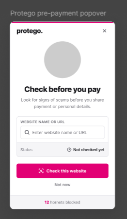
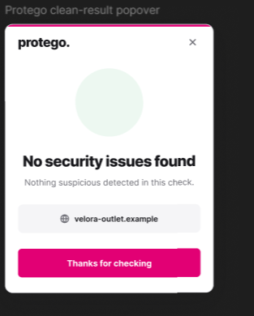
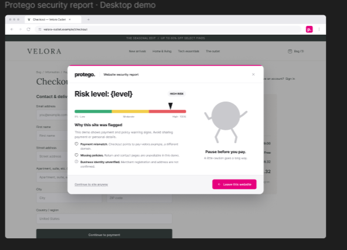
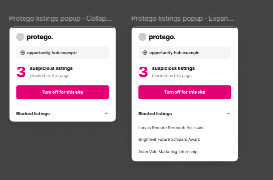

# Protego - Web Extension

## Important

- Backend functions must be usable for a mobile app and website
- Majority of your backend must be built on Spacetime.

## General

Runs in the background of your browser checking and removing any hazards/scams. On new website will run a security check in order to show the user how safe the website with a security report. Addtionally it will block fake job listings and scholarships(when applicable).  
By default when not on a website on click will show:


## Website Security Check

On new website checks entire website and fact checks to ensure it's trustworthy. Risk ratings are None(no issues), Low(some suspicous things, but generally safe), Medium(suspicous or bad practice, but nothing dangerous), High(Highly suspicous and dangerous or on scamming/fraud lists). Some things that contribute to the rating:

- Website Age
- Company Verification(Registered company?)
- Public Opinion
- Suspicous Scripts
- On Scamming/Fraud Lists
- etc.

  This will likely use an agent to do the rating with most of the code being remote.  
   If no risk is detected will show a popup like this(empty circle will be replaced with icon later):
  
  If there is a risk based on the level it will show a popup(react modal like over original website ) like this with the arrow getting worse the higher the risk:
  

## Fake Listing Detection

This feature will remove listings that are suspicous on Job Boards/Scholarship/Apartments(more later for now focus on these three). This will also use agentic AI in order

When on site with fake listings replaces normal on extension icon click popup with this:


## Frontend / Non-Functional extras

- Replace the grayed out images with the corresponding icons
- When seeing a site, Protego will enter the screen, pull open the site, find the hornet, and KILL IT. It will then give a reason for the site being broken(popup in middle of browser with report information).

## Implementation (current)

Built with WXT, React, and TypeScript (Manifest V3). The backend is in `../backend` (SpacetimeDB module plus agent worker); see `backend/README.md`.

```sh
cd web-extension
npm install
cp .env.example .env   # only if not using maincloud/protego
npm run dev            # opens Chrome with the extension loaded and hot reload
npm run build          # production build in .output/chrome-mv3 (load unpacked)
```

| Piece                                                                                     | File                                                                 |
| ----------------------------------------------------------------------------------------- | -------------------------------------------------------------------- |
| Background: identity, scan orchestration, badge, hornet counter                           | `entrypoints/background.ts`                                          |
| Page signals (the privacy boundary: no form values, cookies, query strings, or page text) | `lib/signals.ts`                                                     |
| Auto-scan and the security report modal over the page                                     | `entrypoints/scanner.content/`, `components/RiskReport.tsx`          |
| Fake listings (LinkedIn Jobs, Zillow, Apartments.com)                                     | `entrypoints/listings.content/`, selectors in `lib/listing-sites.ts` |
| Popup: check view, clean result, risk result, listings view                               | `entrypoints/popup/App.tsx`                                          |

Behavior decisions:

- Every new domain is scanned once. Results are cached globally in Spacetime for 24h and locally for 6h.
- The toolbar badge shows the result (✓ / ! / !!). The modal opens for medium and high risk, and for low risk on checkout pages.
- "Continue to site anyway" silences the modal for that domain for the rest of the browser session.
- Suspicious listings collapse into a pink stub with a "Show anyway" link. "Turn off for this site" is stored locally and synced to Spacetime as a SHA-256 hash of the domain.
- Hornets: +1 per risky (medium/high) site warning, at most once per site per day, plus +1 per hidden listing.
- The gray placeholder circles now use the character art (`public/characters/`). The hornet-killing entrance animation should attach to `[data-protego-hornet-slot]` in `RiskReport.tsx`.

## Frontend / Non-Functional extras

- Replace the grayed out images with the corresponding icons
- When seeing a site, Protego will enter the screen, pull open the site, find the hornet, and KILL IT. It will then give a reason for the site being broken(popup in middle of browser with report information).
