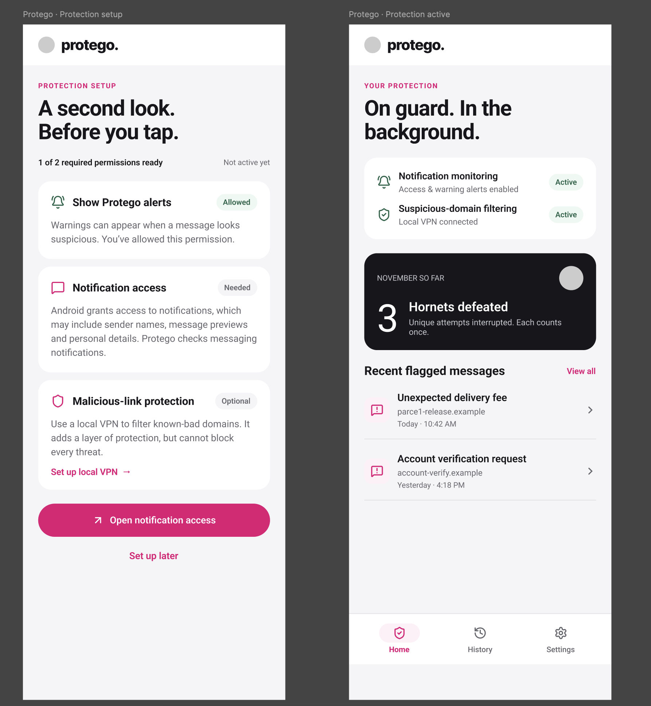
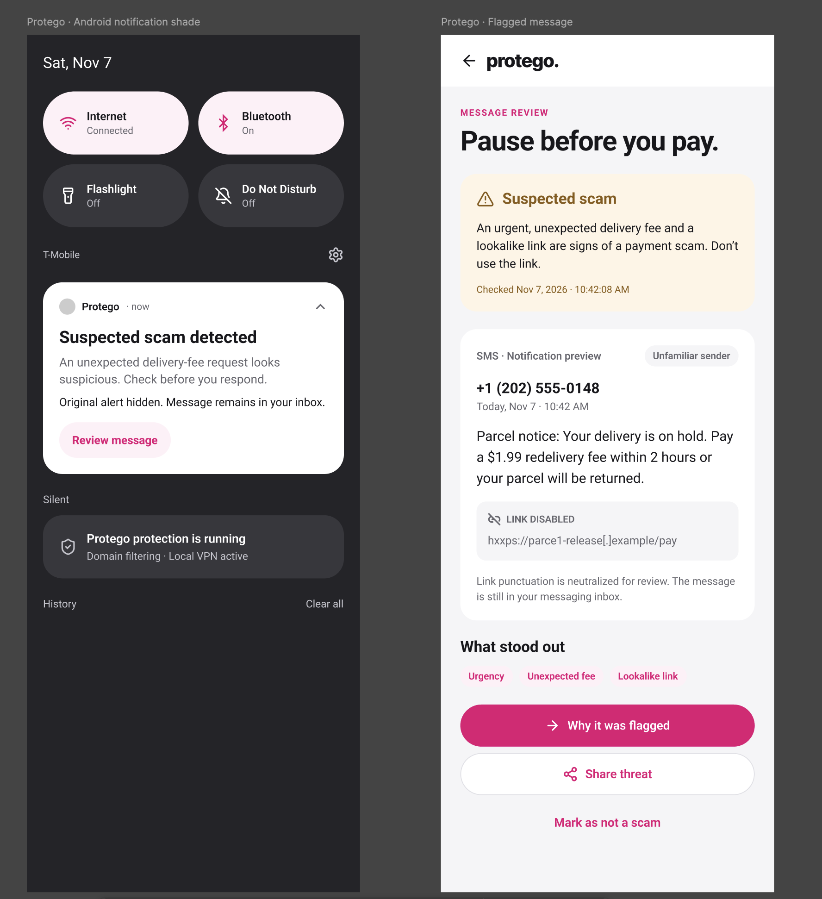
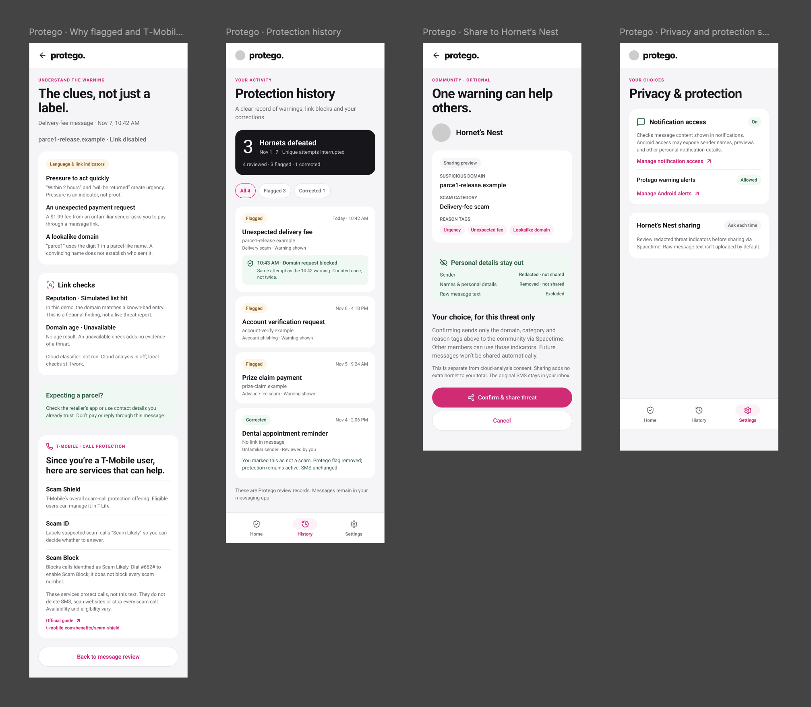

# Tango - Phone App

## Important

- Android application developed with Android Studio.
- Backend functions should be shared with the web extension and website, with the majority of the backend built on Spacetime.
- The screens below are design mockups for the planned app.
- Use the T-Mobile character Light mode asset in the gray placeholder positions.
- The primary protection happens in the background. The app screens explain warnings, show protection history, and manage permissions.
- Hiding a notification does not delete the SMS or RCS message. The original message remains in the user's messaging inbox.
- Demo findings must be labeled as simulated. An unavailable check is not evidence of a threat.

## General

Tango checks incoming messaging notifications for signs of scams and warns users before they respond or open suspicious links. Optional local VPN filtering adds another layer of protection against known-bad domains.

The main navigation includes Home, History, and Settings. Selecting a flagged message opens its review screen, with options to see why it was flagged, share redacted threat indicators, or mark it as not a scam.

Example flow:

- A suspicious text arrives and Tango checks the content available in its notification.
- If it looks like a scam, Tango hides the original notification and posts its own warning.
- The user taps Review message to inspect the notification preview and the warning signs.
- Optional domain filtering can block a request to a known-bad domain.
- The user can review an explanation, correct the flag, or choose to share threat indicators with the Hornet's Nest via Spacetime.

## Protection Setup

Shows the permissions needed for protection and whether each is ready:

- Show Tango alerts: allows the app to display warning notifications.
- Notification access: allows Tango to inspect messaging notifications. Explain that Android notification access may expose sender names, message previews, and personal details.
- Malicious-link protection: optional local VPN setup for filtering known-bad domains.

Show a required-permission readiness count and an inactive state until the required permissions are ready. Open notification access takes the user to Android's notification-access settings. Set up local VPN starts the optional VPN setup. Set up later lets the user continue without implying that protection is active.

## Home / Protection Active

Shows the current state of notification monitoring and optional suspicious-domain filtering. Distinguish active, missing-permission, and disconnected states.

- Display hornets defeated for the current period.
- Count each unique scam attempt once. A warning and a later domain block for the same attempt do not count twice.
- Show recent flagged messages with their title, domain, and time.
- Selecting a recent message opens its review screen.
- View all opens protection history.



## Background Protection / Warning Notification

The implemented notification flow uses NotificationListenerService to inspect incoming SMS and RCS notification previews. When a message is flagged, use cancelNotification() to hide the original alert and post a Tango warning with a Review message action.

The warning should say that a suspected scam was detected and explain that the original alert was hidden while the message remains in the inbox. Avoid saying that the message itself was blocked or deleted.

Optional DNS filtering through VpnService uses a local VPN to filter known-bad domains. Show its actual connection state and the ongoing protection notification when running. This adds protection but cannot block every threat.

## Flagged Message Review

Shows the suspected scam and the content captured from its notification preview:

- Warning summary and time checked.
- Message type, sender, and received time.
- Available message preview, with suspicious URLs neutralized and non-clickable inside Tango.
- Reason tags such as urgency, unexpected fee, and lookalike link.
- A reminder that the original message is still in the messaging inbox.

Why it was flagged opens the explanation screen. Share threat opens a sharing preview rather than immediately uploading data. Mark as not a scam records a correction and removes the Tango flag without changing the original message.



## Scam Detection / Why It Was Flagged

Use cheap checks first and AI only when needed:

- Heuristics: urgency words such as “act now” or “account suspended,” shortened URLs, lookalike domains such as paypa1-secure.com, unfamiliar senders, odd short codes, and requests for gift cards, cryptocurrency, or payment. Treat these as indicators rather than proof.
- URL reputation: planned integrations include Google Safe Browsing, URLhaus, PhishTank, or VirusTotal. Domain-age checks through RDAP can provide additional context when available.
- LLM classification: when local checks are inconclusive and cloud analysis is enabled with consent, send the message and URL findings to the Claude API for a structured classification. The reasons field powers the explanation screen.

Example classification response:

```json
{
  "is_scam": true,
  "confidence": 0.92,
  "category": "package delivery",
  "reasons": ["Unexpected payment request", "Lookalike domain"]
}
```

Explain the specific clues in plain language, including pressure to act quickly, an unexpected fee, or a misleading domain. Show URL-check findings separately from language indicators. Label a simulated reputation hit as a demo result, an unavailable domain-age lookup as unavailable, and a classifier that did not run as not run. Local checks should remain usable when cloud analysis is off.

Include a practical next step, such as checking a delivery through the retailer's official app or contacting the company using trusted details instead of replying through the suspicious message.

## T-Mobile Services

The explanation screen assumes a T-Mobile user and includes a section such as: “Since you're a T-Mobile user, here are services that can help.”

The mockup includes Scam Shield, Scam ID, and Scam Block, with a link to T-Mobile's official guide. Explain their role as additional call protection and keep it separate from Tango's message analysis. These services should not be described as deleting SMS messages or resolving the flagged text. Availability and eligibility may vary.

## Protection History / Hornets Defeated

Shows Tango's review records, including warnings, domain blocks, and user corrections. These are app records; the original messages remain in the messaging app.

- Show the total hornets defeated and the selected period.
- Include reviewed, flagged, and corrected counts.
- Support All, Flagged, and Corrected filters.
- Each record includes a status, time, title, domain when present, scam category, and action taken.
- Group related actions under one attempt, such as a warning followed by a domain block, and count that attempt once.
- Corrected records explain that the user marked the message as not a scam, the Tango flag was removed, and protection remains active.

## Share to Hornet's Nest

Sharing is optional and requires confirmation for each threat. The preview shows exactly what will be shared through Spacetime:

- Suspicious domain.
- Scam category.
- Reason tags.

Redact the sender, remove names and other personal details, and exclude raw message text by default. Confirm & share threat sends only the previewed indicators. Cancel returns without sharing. Confirming one threat does not enable automatic sharing for future messages.

Sharing consent is separate from cloud-analysis consent. Sharing adds no extra hornet to the user's total and does not change the original SMS.

## Privacy & Protection Settings

Shows notification access, Tango warning-alert permission, and Hornet's Nest sharing preferences.

- Manage notification access opens the corresponding Android settings.
- Manage Android alerts opens the app's notification settings.
- Show the real permission states rather than a fixed active label.
- Hornet's Nest sharing defaults to Ask each time, with a reminder to review redacted indicators before sharing.
- Explain that cloud classification sends message content to a server. Obtain separate consent and redact personal details before transmission. On-device analysis is a possible future alternative.



## Frontend / Non-Functional extras

- Match the mockups' pink accents, light backgrounds, rounded white cards, and dark hornets-defeated summary cards.
- Use the T-Mobile character Light mode asset for the logo and character positions.
- Use green for active protection and corrected records, and amber for suspected-scam warnings.
- Keep suspicious links non-clickable in Tango's review screens.
- Highlight the current Home, History, or Settings tab in the bottom navigation.
- Detail screens provide a back action to the previous screen.


## Native Warning Animation

Use the same visual sequence as the extension, adapted for a portrait app screen. Medium risk rolls the suspicious light-mode character into view and pops out its limbs before presenting warning clues. High risk first reveals a hornet, then rolls in the angry light-mode character, pops out its limbs, slashes the hornet into pieces, and presents the warning and protection tip.

Trigger the sequence before reviewing an active medium/high-risk message, including when opening the demo notification. Low-risk and corrected records bypass it. Home provides separate medium/high demo preview buttons; active message reviews provide replay. Respect Android's animation scale, stop sounds while backgrounded, and provide Skip animation and a sound toggle. The sequence stays inside the app and does not modify messages or add hornets.


## Current Text-Warning Implementation

The notification listener performs on-device heuristic checks on incoming messaging previews, posts a real warning when multiple indicators are present, and requests dismissal of the matching original alert only after replacement delivery. SMS/RCS content in the messaging inbox is never deleted or modified. Actual cancellation confirmation is recorded from Android's removal callback.

Real warnings, previews, local explanations, corrections, and action state are saved privately on-device, capped at 200 records. Real and demo records are separate. Permission and channel failures retain the original alert; unposted warnings are not counted as warned attempts. No raw message text is uploaded and URL reputation/cloud checks remain unconnected.

See TESTING-MESSAGE-WARNINGS.md for manual steps. This change was implemented without running builds or tests.
